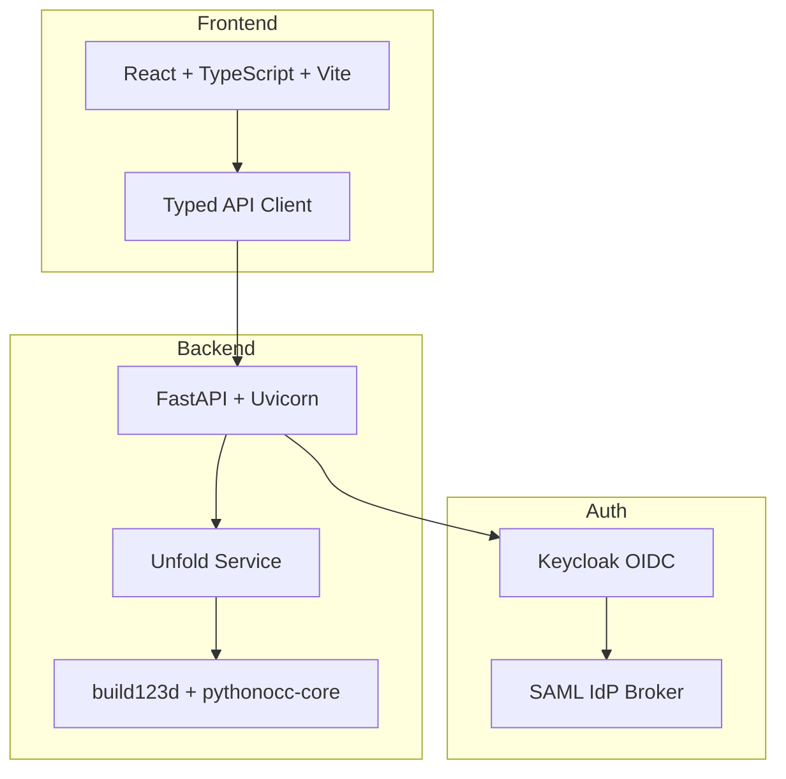

# Signal Engine

> Work in progress. This checkpoint may be incomplete or fail tests. See PLAN.md and STATUS.md before use.


**Ryan Vo | AI & Machine Learning**

Signal Engine is an AI/ML developer tool for CAD automation that gives your agent sheet-metal superpowers. It converts bent 3D solids into manufacturing-ready flat patterns with bend lines, using a deterministic geometric unfolding engine.

## Problem

Sheet-metal parts designed in CAD (bent brackets, enclosures, chassis) need to be unfolded into flat blanks for laser/waterjet cutting and press-brake forming. Existing tools either:
- Only handle already-flat parts (`cadgen.flatten`)
- Require manual bend allowance calculations
- Lack integration with manufacturing workflows (SendCutSend, DFM checks)

## Solution

Signal Engine implements `cadgen.unfold` — a complete sheet-metal unfolding engine that:
1. **Detects thickness** from parallel planar face pairs with opposite normals
2. **Identifies bends** from coaxial cylindrical face pairs (radius difference = thickness)
3. **Computes bend allowance** using K-factor formula: `BA = θ·(r + K·t)` or shop bend tables
4. **Generates flat pattern** via OCC Boolean union + kerf offset
5. **Outputs bend lines** ready for DXF BEND layer
6. **Provides per-bend records** with angle, direction, radius, allowance, flange lengths, and nearest cut/hole distance

## Features

- **Deterministic core**: No LLM required for unfolding; works offline
- **STEP file input**: Upload `.step`/`.stp` files directly
- **Configurable K-factor**: 0.0–1.0 (default 0.33 for mild steel)
- **Kerf compensation**: Laser/waterjet offset
- **Bend table support**: Shop-specific deductions (planned)
- **DXF export**: CUT + BEND layers for manufacturing
- **Volume conservation**: Validates material conservation within K-factor accuracy
- **Explicit refusals**: Non-sheet solids, variable thickness, hems, curls, conical bends, collisions

## Architecture



## Quick Start

### Local Development (Demo Mode)

```bash
# Backend
cd backend
python -m venv .venv
.venv/bin/pip install -r requirements.txt
.venv/bin/python -m uvicorn app.main:app --reload --host 127.0.0.1 --port 8000

# Frontend (separate terminal)
cd frontend
npm install
npm run dev
```

Open http://localhost:5173

### Docker (Demo Mode)

```bash
docker compose --profile demo up --build
```

Open http://localhost:5173

### Production Deployment

1. Configure Keycloak realm with OIDC client
2. Set environment variables (see `.env.example`)
3. Disable `DEMO_MODE`
4. Deploy behind TLS reverse proxy (nginx/Traefik)
5. Configure backup/restore for SQLite volume

## API Reference

### POST `/api/unfold`

Unfold a sheet-metal part from STEP file.

**Request** (multipart/form-data):
- `file`: STEP file (.step/.stp)
- `k_factor`: float (0.0–1.0, default 0.33)
- `kerf`: float (mm, default 0.0)
- `bend_table`: JSON string (optional)

**Response**:
```json
{
  "success": true,
  "unfolded": {
    "profile_svg": "<svg>...</svg>",
    "bend_lines": [[[x1,y1],[x2,y2]], ...],
    "bends": [{
      "index": 0,
      "angle_deg": 90.0,
      "direction": "up",
      "inside_radius": 2.0,
      "bend_allowance": 4.18,
      "k_factor": 0.33,
      "bend_line_start": [10, 10],
      "bend_line_end": [90, 10],
      "flange_length_side_a": 40.0,
      "flange_length_side_b": 60.0,
      "nearest_cut_distance": 15.0,
      "axis_point": [50, 0, 2],
      "axis_direction": [0, 1, 0]
    }],
    "thickness": 2.0,
    "k_factor": 0.33,
    "kerf": 0.0,
    "blank_area": 8236.0,
    "volume": 16472.0,
    "material_conservation_ratio": 1.0013,
    "warnings": []
  },
  "processing_time_ms": 150.0
}
```

### GET `/api/unfold/health`

Health check endpoint.

### GET `/health`

Application health check.

## AI/ML Evaluation

Signal Engine's unfolding engine is a deterministic geometric algorithm — not an ML model. However, it enables AI/ML workflows:

| Aspect | Details |
|--------|---------|
| **Reproducible Baseline** | U-channel test: 2mm sheet, 90° bends, r_in=2mm → blank 82.36×60mm, conservation 1.013 |
| **Data Provenance** | Generated from build123d primitives; no external dataset |
| **Metrics** | Volume conservation ratio, bend angle accuracy, bend line placement |
| **Failure Cases** | Variable thickness, hems (r < t), curls (>180°), conical bends, non-sheet solids |
| **LLM Integration** | Opt-in parameter suggestion (planned); advisory only, grounded in actual geometry |

Run evaluation:
```bash
cd backend
.venv/bin/python -m pytest tests/test_unfold.py::TestVolumeConservation -v
```

## Security

- **Authentication**: OIDC authorization-code with PKCE via Keycloak
- **SAML Support**: Keycloak identity brokering for enterprise IdPs
- **Demo Mode**: Localhost-only, explicit opt-in, refuses in production
- **Tokens**: HttpOnly SameSite cookies (backend sessions) or in-memory (SPA)
- **Secrets**: LLM keys server-side only; never logged
- **File Upload**: Size limits, type validation, temp file cleanup

## Provider Configuration

| Provider | LLM_PROVIDER | LLM_MODEL | LLM_BASE_URL |
|----------|--------------|-----------|--------------|
| OpenAI | openai-compatible | gpt-4o-mini | https://api.openai.com/v1 |
| LiteLLM | openai-compatible | gpt-4o-mini | http://localhost:4000 |
| OpenRouter | openai-compatible | openrouter/auto | https://openrouter.ai/api/v1 |
| Ollama | ollama | llama3.1 | http://localhost:11434 |
| Anthropic | anthropic | claude-3-haiku | https://api.anthropic.com |
| Gemini | gemini | gemini-1.5-flash | https://generativelanguage.googleapis.com |

## SSO/SAML Setup

1. Configure Keycloak realm: `signal-engine`
2. Add OIDC client: `signal-engine-client` with redirect URIs
3. Enable SAML identity brokering for upstream IdP
4. Map SAML attributes to Keycloak roles: `viewer`, `operator`, `admin`
5. Set `OIDC_ISSUER_URL`, `OIDC_AUDIENCE` in environment

## License

MIT © Ryan Vo <ryandtvo@gmail.com>